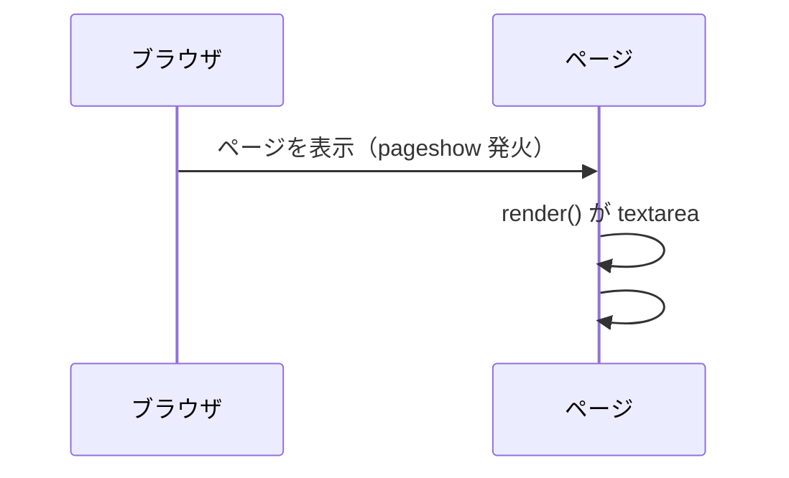
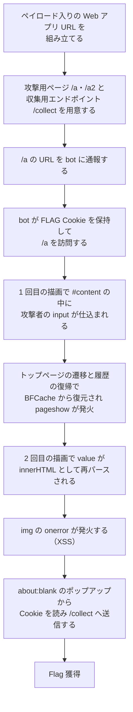

> [!IMPORTANT]
> **Solved with Codex**
>
> この問題は AI コーディングアシスタント **Codex** を活用して解決されました。

> [!NOTE]
> この Writeup は AI により自動生成されています。 本ドキュメントは、AI アシスタントを用いて作成された Writeup です。記載内容は解法の一例であり、内容の正確性については十分にご確認の上ご利用ください。

# Spinnin'

## 概要
*   **カテゴリー**: Web
*   **トピック**: Client-Side
*   **難易度**: Very Hard
*   **問題リンク**: [Spinnin' - Daily AlpacaHack B-SIDE](https://alpacahack.com/daily-bside/challenges/spinnin)

## 使用ツール
本問題を解くにあたって使用したツールは次の通りです。

*   **Python 3**: 解法スクリプトの実装（標準ライブラリのみで動作）
*   **http.server**: 攻撃用ページの配信と Cookie の収集（Python 標準ライブラリ）
*   **urllib**: bot への通報リクエストの送信（Python 標準ライブラリ）
*   **Chromium**: bot が通報先 URL の訪問に使うブラウザ（配布 Dockerfile で使用）
*   **Codex**: 配布ファイルの解析およびコード生成

## 問題の分析
本問題は、**Daily AlpacaHack B-SIDE** の Web 問題です。問題文は次の通りです。

> Guru guru~
> （日本語版：ぐるぐる〜）

問題ページでインスタンスを起動（Spawn）すると、Web アプリ・bot・RequestBin の各サービスに接続できるようになります。配布ファイルは次の通りです。

| ファイル | 内容 |
| :--- | :--- |
| `web/index.js` | クエリパラメータ `content` を DOMPurify でサニタイズしてテンプレートに渡す Web アプリ |
| `web/views/index.ejs` | サニタイズ済みの文字列を textarea に埋め込み、`pageshow` のたびに `innerHTML` へ描画するページ |
| `bot/bot.js` | フラグを Cookie に設定し、通報された URL を Chromium で訪問する bot 本体 |
| `bot/index.js` | URL の通報を受け付けるエンドポイント（`/api/report`）を持つサービス |
| `compose.yaml` | Web アプリ、bot、RequestBin の 3 サービスを起動する Docker Compose 設定 |

Web アプリ側の処理は、突き詰めると次の 1 行です。

```javascript
const content = DOMPurify.sanitize(String(req.query.content || ""));
```

サニタイズされた文字列は EJS のエスケープを経て `<textarea id="input">` の中身として埋め込まれます。ページのスクリプトは、表示のたびに次の `render()` を実行します。

```javascript
function render() {
  const content = document.getElementById("input").value;
  document.getElementById("content").innerHTML = content;
}

addEventListener("pageshow", render);
```

bot は、フラグの値を `FLAG` という名前の Cookie として保持した状態で通報先の URL を開き、5 秒間待機します。

```javascript
await page.setCookie({
  name: "FLAG",
  value: FLAG,
  domain: new URL(APP_URL).hostname,
  path: "/",
});
```

ポイントは次の 3 つです。

1. `content` は DOMPurify でサニタイズされますが、`input` 要素やその `value` 属性は除去されません。しかもサニタイズ済みの文字列はまず textarea の中身になるため、最初の描画ではただの文字列として扱われます。
2. `render()` は `pageshow` のたびに実行され、`document.getElementById("input")` の `value` を `#content` の `innerHTML` に代入します。HTML の中で `#content` は textarea より**文書順で前**に現れます。
3. bot は Render ボタンをクリックしません。そのため、クリックなしで `render()` をもう一度実行させる必要があります。また、`FLAG` Cookie には `HttpOnly` 属性が付いていません。

通常の描画の流れを図にすると次のようになります。



## 脆弱性の詳細

### DOM Clobbering で `getElementById` の結果をすり替える
`document.getElementById("input")` は、文書の中で `id="input"` を持つ**最初の**要素を返します。元のページには textarea が 1 つだけですが、`#content` の中に `<input id="input" ...>` を描画させることができれば、次回の `render()` ではその input のほうが先に見つかります。これが DOM Clobbering です。すり替わった要素の `value` は攻撃者が自由に決められるため、`render()` が `innerHTML` に代入する文字列そのものを支配できます。

### `value` の中身は「文字列」から「HTML」へ変わる
仕込む input の `value` 属性には、img タグの文字列を隠しておきます。

```html
<input id=input value="">
```

この文字列は、段階ごとにまったく違う扱いを受けます。

| 段階 | `value` の中身の扱い |
| :--- | :--- |
| サニタイズ時 | 属性値のテキスト。DOMPurify は `input` 要素と `value` 属性を許可するためそのまま残る |
| 1 回目の描画 | textarea 経由で文字列として取り出され、`innerHTML` で input 要素になる。この時点では `value` の中身はただの文字列で、img 要素は存在しない |
| 2 回目の描画 | すり替わった input の `value` が `innerHTML` に代入され、**HTML として再パースされる**。img 要素と `onerror` が有効になる |

つまり危険なマークアップは、サニタイズを「すり抜けた」のではなく、文字列として無害な形で保管され、アプリケーション自身の再描画によって有効化されます。`onerror` 属性の区切りには `&quot;` を使います。1 回目のパースでは属性値の中のテキストとして保持され、2 回目のパースで初めて引用符として機能します。

### クリックなしで 2 回目の描画を起こす
`pageshow` イベントは、ページが BFCache（Back/Forward Cache）から復元されたときにも発火します。これを利用すると、bot にクリックさせなくても 2 回目の `render()` を起こせます。

1. 攻撃者のページが、Web アプリの URL を iframe で埋め込む
2. 読み込み後、攻撃者のトップページを別のページへ遷移させる
3. 遷移先で `history.back()` を呼ぶと、攻撃者のページが BFCache から復元される
4. 復元に伴い iframe 内の Web アプリでも `pageshow` が発火し、2 回目の `render()` が走る

bot の訪問は 5 秒間あるため、この一連の遷移はその時間内に収まります。

### iframe の中からは Cookie が読めない
XSS が発火するのは iframe の中の Web アプリです。しかし近年のブラウザは、トップレベルとは異なるオリジンの iframe の文脈では Cookie の読み書きを制限します。そこで、発火したコードから `window.open('about:blank')` でポップアップを開きます。`about:blank` の文書は開いたページ（Web アプリ）のオリジンを継承し、しかもトップレベルの文脈になるため、`document.cookie` で `FLAG` Cookie を読むことができます。あとはその値を、攻撃者の収集用エンドポイントへのリクエストに付けて送るだけです。

## 攻撃フロー


> [!TIP]
> 通報を受け付けるエンドポイントにはレート制限（1 分あたり 4 回まで）があります。一度の通報で完結するよう組み立ててから送るのが確実です。確認や試行のための通報の繰り返しは必要最小限に留めてください。過剰に繰り返すと、共有のインスタンスやプラットフォーム側に無駄な負荷をかけてしまいます。

## 補足

<details>
<summary>補足: DOMPurify の不備ではない理由（クリックで展開）</summary>

DOMPurify の役割は、渡された文字列を「HTML として挿入しても安全」な形にすることです。この攻撃のペイロードは、サニタイズ時点では許可された要素と属性だけで構成されており、文字列として保管される間は無害です。問題はサニタイズそのものではなく、サニタイズ済みの文字列を textarea の値として取り出し、改めて `innerHTML` に代入するという、アプリケーション側の二段階のパースにあります。サニタイザの想定する文脈と、実際に使われる文脈がずれていることが本質です。

</details>

<details>
<summary>補足: `&quot;` が必要な理由（クリックで展開）</summary>

仕込む input の `value` 属性は二重引用符で区切られています。その内側に img タグの `onerror` 属性を書くには、内側でも引用符が必要です。生の二重引用符を書くと外側の属性値がそこで終わってしまいますが、`&quot;` と書けば、1 回目のパースでは属性値の中の文字として保持され、2 回目のパース（`innerHTML` への代入）のときに引用符として解釈されます。この「解釈されるタイミングのずれ」が、二段階パース攻撃の肝になっています。

</details>

<details>
<summary>補足: `HttpOnly` が付いていたら（クリックで展開）</summary>

`FLAG` Cookie に `HttpOnly` 属性が付いていると、JavaScript の `document.cookie` からはその Cookie を読めなくなります。その場合、「ポップアップから Cookie を読んで送る」という攻撃の最後の段階は成立しません。ただし、XSS 自体が成立する状況は変わらないため、`HttpOnly` は被害を抑える多層防御の一つであって、XSS 対策そのものの代わりにはなりません。

</details>

> [!WARNING]
> この問題の本質は、**サニタイズ済みの文字列が、別の文脈で再パースされることで有効化される**点にあります。文字列を一度無害化しても、`innerHTML` への代入のような再解釈が挟まれば、保管されていたマークアップが実行可能な形で蘇ります。さらに、同じ `id` を持つ要素の注入を許す DOM 構造や、機密情報を保持する Cookie への `HttpOnly` の付け忘れが重なると、「自分で入力した内容を自分で描画するだけ」の処理が、bot を相手にした完全な XSS へと変わります。実システムでは、ユーザー入力を `innerHTML` に代入しないこと、`id` の一意性を保つこと、機密 Cookie に `HttpOnly` を付けることを、組み合わせて守ることが重要です。

## 用語解説
*   **XSS（クロスサイトスクリプティング）**: Web ページに攻撃者の用意したスクリプトを注入し、閲覧者のブラウザで実行させる攻撃です。今回は、ページ自身の描画処理を介してスクリプトが有効化されます。
*   **DOM Clobbering**: ページ内に `id` などを持つ要素を注入し、スクリプトが名前で参照している要素やプロパティをすり替える手法です。今回は `getElementById("input")` の結果をすり替えています。
*   **DOMPurify**: HTML 文字列をサニタイズ（無害化）するためのライブラリです。危険な要素や属性を取り除きますが、安全かどうかは「どの文脈で使うか」に依存します。
*   **BFCache（Back/Forward Cache）**: ブラウザが履歴の「戻る」「進む」を高速化するために、ページ全体をメモリ上に保持しておく仕組みです。復元時には読み込み直しではなく `pageshow` イベントが発火します。
*   **`pageshow`**: ページが表示されるたびに発火するイベントです。新規の読み込みだけでなく、BFCache からの復元時にも発火します。
*   **EJS**: JavaScript のテンプレートエンジンです。`<%= %>` は値を HTML エスケープして埋め込む記法で、今回の文字列はまずこの形で textarea の中身になります。
*   **`HttpOnly`**: Cookie に付ける属性で、JavaScript からその Cookie を読めなくします。XSS が起きた場合の被害を抑えるための属性です。
*   **サードパーティ Cookie の制限**: トップレベルのサイトとは異なるオリジンの文脈（iframe 内など）では、近年のブラウザは Cookie の読み書きを制限します。この攻撃では、ポップアップを開いてトップレベルの文脈に移ることで、この制限を迂回します。

## 解決スクリプト
[solve.py を参照してください](./solve.py)

```bash
python3 solve.py --bot-url http://localhost:1337 --web-url http://web:3001 --public-base http://127.0.0.1:18080
```

スクリプトは、攻撃用ページ（`/a`、`/a2`）と収集用エンドポイント（`/collect`）を自前で配信し、`/a` の URL を bot に通報して、送られてきた Cookie からフラグを取り出します。`--web-url` と `--public-base` には、bot のブラウザから到達できる URL を指定してください。追加のライブラリは不要で、Python の標準ライブラリだけで動作します。
